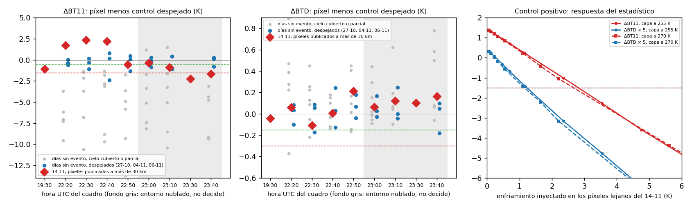
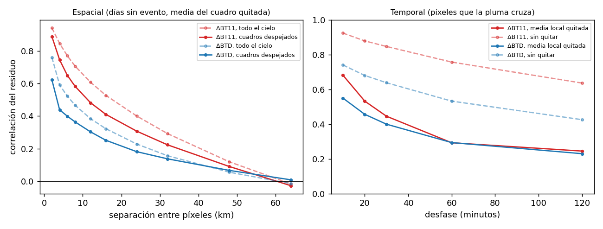

# H22 (S17): ¿la pluma desprendida del 14-11 tiene señal infrarroja contra la línea base de sus propios píxeles? Informe, 22-11-2026

**Veredicto (regla del criterio): sin señal infrarroja medible a más de 30 km del cráter.** En los 70 píxeles que
deciden, la temperatura de brillo de 11 µm y la diferencia 11 − 12 µm caen en la zona nula, y el control positivo
pasa. Los píxeles que VOLCAT publica no están más fríos que lo esperado: están 1,4 K más tibios que su control
despejado. β no se puede medir ahí (3 píxeles con dato): SIN DATO.

Criterio escrito y subido antes de medir la pluma: commit `a99fc9a`,
`C:\Users\nmend\OneDrive\Escritorio\claude\Volcanologia\Goes\docs\own_volcat\h22_pluma_desprendida\criterio_2026-11-22.md`.
Mientras el PR no se fusione, todo está en
`C:\Users\nmend\OneDrive\Escritorio\claude\Volcanologia\Goes\.claude\worktrees\agent-ac1cbe11e0b1e665c\docs\own_volcat\h22_pluma_desprendida\`.
Lo decidido después de ver la pluma está rotulado "post hoc" (sección 6). Investigación: nada de esto toca el
dashboard ni `src/`.

## 1. Para geólogo

**La idea que se probó.** Todas las pruebas sobre la cumbre de Chillán fallaron, y la sospecha era el fondo: la
cumbre es térmicamente rugosa. El evento largo del 14-11 (16:30 a 23:40 UTC) se desprende hacia el ESE y termina a
61 a 82 km del cráter. Lejos de la cumbre el fondo debería ser más quieto, y ahí se podría ver si la pluma enfría
los píxeles (una capa de ceniza a varios kilómetros de altura es más fría que el suelo) o si baja la diferencia
entre 11 y 12 µm (la firma clásica de la ceniza).

**Lo que resultó del fondo, antes de mirar la pluma.**

1. **La pluma desprendida no sale de la cordillera.** Los píxeles lejanos tienen una cota mediana de 2.161 m, igual
   que los cercanos (2.127 m). No hay "terreno bajo y parejo" en el camino de esta pluma.
2. **El ruido que manda es el tiempo, no el terreno.** Un día sin objeto VOLCAT no es un día despejado: en los 15
   días de comparación, sólo el 28 % de los píxeles estaba despejado a esas horas. Una nube meteorológica enfría el
   píxel 10 a 50 K; cualquier efecto de una pluma tenue queda enterrado si no se separa el cielo despejado.
3. **Con cielo despejado el residuo no es ruido blanco: es coherente.** Toda la zona amanece más tibia o más fría
   que los seis días previos (unos 3 K de un día a otro). Quitado eso queda 1,2 K por píxel en 11 µm, parecido
   entre vecinos hasta unos 15 a 20 km y entre cuadros seguidos hasta media hora. En la diferencia 11 − 12 µm el
   resto es 0,23 K: esa medida es mucho más quieta.
4. **Con ese fondo, el umbral de la lista de ideas (0,5 K) no se puede resolver.** La misma huella puesta en un día
   limpio sin pluma (06-11) da 1,2 K "más fría" que su control por puro fondo. Por eso el criterio pide 1,5 K para
   hablar de señal y deja 0,5 K sólo como límite de la zona nula.
5. **El 14-11 se nubla al final.** El entorno de la pluma lejana está despejado en 70 a 91 % entre 22:20 y 22:50,
   y en 3 a 38 % desde las 23:00. Sólo los primeros cuadros permiten una comparación limpia: 70 de los 192 píxeles
   lejanos.

**Lo que resultó de la pluma.**

- **A más de 30 km, con entorno despejado (70 píxeles, 22:20 a 22:50 más un píxel de las 19:30):** los píxeles
  publicados están 3,3 K sobre su propia línea base y 1,4 K sobre píxeles despejados de la misma cota y la misma
  temperatura esperada. Ninguno está más de 3 K bajo su control. La diferencia 11 − 12 µm es igual a la del control
  (+0,08 K). No hay enfriamiento ni firma de ceniza.
- **A más de 30 km, con entorno nublado (122 píxeles, 23:00 a 23:40):** quedan 0,9 K bajo los pocos controles
  despejados que hay, dentro de lo que pasa en días sin pluma con ese cielo; la diferencia 11 − 12 µm tampoco baja.
  No se puede atribuir nada a la pluma ahí.
- **Cerca del cráter (30 km o menos), en los tres tramos de sol:** en ninguno la huella queda del lado "más frío"
  de su rango de días sin pluma. No aparece señal ni cerca ni lejos, ni con sol alto ni con sol bajo.

**Qué habría visto la prueba.** Se inyectó una capa sintética en los mismos píxeles. La regla la marca cuando la
capa tiene una emisividad en 11 µm de 0,10 a 0,15 o más (enfría 1,7 a 2,4 K y baja la diferencia 11 − 12 µm en
0,5 a 0,7 K). Una capa más tenue que eso no se habría visto. Una capa a la temperatura del suelo tampoco: al
atardecer el suelo de la cordillera está a unos 281 K y una capa a 270 K casi no contrasta.

**Lo que esto dice de VOLCAT.** Para esos mismos 70 píxeles, VOLCAT informa una carga de ceniza de 7,2 g/m² de
mediana y una altura de 3,75 km, con probabilidad infrarroja máxima de 0,12. INFERENCIA: una capa de ceniza de
7 g/m² sería casi opaca en 11 µm y enfriaría esos píxeles varios kelvin; la prueba la habría marcado sin dificultad
(una capa a 270 K con emisividad 0,5 da −4,4 K en el estadístico). Lo observado es +1,4 K. La carga que VOLCAT
escribe en esos píxeles no corresponde a lo que el infrarrojo de la L1b muestra ahí. Vale la pena preguntárselo a
Pavolonis en el correo.

**Conclusión.** La idea 3 queda respondida: sacar la pluma de la cumbre no hace aparecer una señal infrarroja.
El problema no era sólo el fondo de la cumbre. La pluma del 14-11 es, para el infrarrojo térmico de 2 km,
transparente (o está a la temperatura del suelo) también cuando se la compara contra sus propios píxeles en cielo
despejado. Lo que VOLCAT sigue durante esas horas no se sostiene en 11 y 12 µm.

**Números principales (población que decide, control despejado pareado).**

| Medida | 14-11, píxeles publicados | Mismos píxeles en 3 días limpios sin pluma | Zona |
|---|---|---|---|
| ΔBT11, diferencia contra el control | +1,44 K (AUC 0,33) | −1,19, +0,08 y +0,19 K (AUC 0,69, 0,48 y 0,50) | nula |
| ΔBTD (11 − 12), diferencia contra el control | +0,08 K (AUC 0,41) | −0,09, +0,06 y +0,16 K (AUC 0,62, 0,42 y 0,31) | nula |
| β(12/11) | 3 píxeles con dato | sin dato | SIN DATO |
| Píxeles más de 3 K bajo su control | 0 % | 1 %, 3 % y 7 % | |

Rombos rojos: 14-11. Puntos azules: la misma huella en los tres días sin evento y despejados. Puntos grises: días
sin evento con cielo cubierto o parcial. Líneas de trazos: límite de la zona de señal (rojo) y de la zona nula
(verde). El número bajo cada cuadro es la cantidad de píxeles. A la derecha, cómo responde el estadístico cuando se
inyecta una capa sintética en el 14-11.

## 2. Estructura del ruido de fondo (tarea 1)

Script `scripts/h22_ruido.py`, salida completa en `resultados/ruido_salida.txt`. Días placebo: los 15 días, del
26-10 al 17-11, en que todos los cuadros de 16:30 a 23:40 UTC son de clase N de H9 (sin ceniza VOLCAT a 50 km ni
en ± 60 min) y no hay archivo de evento. Píxeles: los 195 que la pluma del 14-11 cruza (84 a 30 km o menos, 111 a
más de 30 km). Línea base: percentil 75 de BT11 del mismo píxel en los 6 días previos, a la misma hora ± 20 min.

**Media y dispersión del residuo** (todas las horas del evento; entre paréntesis, 22:00 a 23:40):

| Zona | Cielo | ΔBT11 mediana | ΔBT11 desviación | ΔBTD mediana | ΔBTD desviación | β mediana (fracción con dato) |
|---|---|---|---|---|---|---|
| Lejos | todo | −12,5 K | 18,5 K (11,9) | −0,05 K | 0,82 K (0,61) | 0,97 (76 %) |
| Lejos | despejado, 28 % | +2,6 K | 4,3 K (3,3) | +0,07 K | 0,46 K (0,35) | 1,04 (13 %) |
| Cerca | todo | −13,5 K | 16,5 K (12,2) | −0,10 K | 0,76 K (0,60) | 0,97 (76 %) |
| Cerca | despejado, 29 % | +3,3 K | 4,7 K (4,3) | +0,12 K | 0,42 K (0,34) | 1,10 (16 %) |

"Despejado" = píxel a no más de 3 K bajo su línea base. La mediana positiva en cielo despejado sale de la propia
definición (se descarta la cola fría). β sólo existe donde el píxel está al menos 1 a 1,5 K bajo su base: en cielo
despejado hay poco dato, y en cielo cubierto lo que mide es la nube meteorológica.

**Descomposición con cielo despejado, píxeles lejanos, 22:00 a 23:40:**

| Componente | ΔBT11 | ΔBTD |
|---|---|---|
| Modo común del cuadro (toda la zona, día a día) | 2,8 K | 0,35 K |
| Sesgo fijo de cada píxel | 0,5 K | 0,06 K |
| Resto | 1,2 K | 0,23 K |

**Autocorrelación** (figura): espacial, con la media del cuadro quitada, en cuadros despejados: ΔBT11 0,89 a 2 km,
0,58 a 8 km, 0,41 a 16 km, 0,22 a 32 km y 0,09 a 48 km; ΔBTD 0,62, 0,36, 0,25, 0,14 y 0,07. Temporal, con la media
local quitada: ΔBT11 0,68 a 10 min, 0,45 a 30 min, 0,29 a 60 min y 0,00 a 24 h; ΔBTD 0,55, 0,40, 0,29 y 0,16.

**Con la cota:** dentro de un cuadro despejado el residuo tiene pendiente con la altura, pero cambia de signo de un
cuadro a otro (ΔBT11: mediana +0,27 K por km, desviación entre cuadros 1,96 K por km; ΔBTD: +0,06 y 0,16).

**Variantes de línea base:** en cielo despejado dan dispersiones de ΔBT11 de 3,1 a 7,3 K con 6 días, según el
percentil y la ventana horaria (10,7 K con 3 días). La de H17 (± 90 min) da 3,7 K; la de ± 20 min, 4,5 K. Ninguna quita el modo común; lo quita el control del
mismo cuadro. Se usó ± 20 min por el enfriamiento rápido del suelo al atardecer (decisión tomada antes de mirar la
pluma).

**Cómo lo toma la prueba.** El residuo es coherente en el espacio (15 a 20 km), en el tiempo (media hora) y de un
día a otro (modo común). Por eso:

1. El control es siempre del mismo cuadro (quita el modo común), de la misma banda de cota (± 300 m) y con la misma
   BT11 esperada (± 1 K), y despejado.
2. No se informan intervalos de confianza por píxel: los píxeles de una huella no son independientes. La
   comparación es contra la misma huella en días sin evento (placebo temporal) y contra la huella corrida dentro
   del mismo día (placebo espacial).
3. El cielo del entorno decide qué cuadros son comparables. Con entorno nublado, la huella puesta en días sin
   pluma da diferencias de −12,3 a +0,4 K: ahí un enfriamiento no dice nada.
4. Cerca del cráter el sesgo no es cero ni en días limpios (1,5 a 6,2 K bajo el control despejado en 5 de 6 días):
   es el residuo coherente de la cumbre. Cerca del cráter el resultado sólo se lee contra ese rango.

**Ruido del estadístico de la prueba** (misma huella, días sin evento con entorno despejado, píxeles lejanos de
los cuadros que deciden): ΔBT11 −1,19, +0,08 y +0,19 K, con AUC hasta 0,69; ΔBTD −0,09, +0,06 y +0,16 K, con AUC
hasta 0,62. Sólo 3 de los 15 días placebo tienen ese cielo.

## 3. Veredicto contra el criterio (tarea 2)

Población que decide: 70 píxeles publicados a más de 30 km (distancia mediana 36 km, cota mediana 2.259 m) en los
cuadros de 19:30, 22:20, 22:30, 22:40 y 22:50 UTC, con entorno despejado de 70 a 91 %. Cenit solar 43,5° (1 píxel)
y 77,2° a 83,0° (69 píxeles). Los 70 tienen control despejado.

| Regla | Pide | Da | Resultado |
|---|---|---|---|
| ΔBT11, zona nula | D > −0,5 K y AUC < 0,6 | D = +1,44 K, AUC 0,33 | cumple |
| ΔBTD, zona nula | D > −0,15 K y AUC < 0,6 | D = +0,08 K, AUC 0,41 | cumple |
| Zona de señal (alguna) | ΔBT11: D ≤ −1,5 K y AUC ≥ 0,7; ΔBTD: D ≤ −0,3 K y AUC ≥ 0,7 | ninguna | no hay señal |
| Fuera del rango placebo hacia el lado de ceniza | D bajo el mínimo y AUC sobre el máximo de los días limpios | no, en las dos medidas | no hay señal |
| Control positivo | toda inyección que enfría 2 K o más, marcada en los 3 días limpios y en el 14-11 | sí (5 de 5 inyecciones) | pasa |
| **Veredicto** | | | **sin señal IR medible a más de 30 km** |

Sensibilidad a la elección del control (no decide): con todo el cielo como control, ΔBT11 D = +1,75 K (AUC 0,27) y
ΔBTD +0,06 K (AUC 0,46); con el pareo por BT11 observada (convención anterior), ΔBTD −0,03 K (AUC 0,55), dentro de
su rango placebo (−0,12 a +0,08 K; AUC 0,40 a 0,66).

Placebo espacial (323 corrimientos de la huella dentro del 14-11): la huella real está entre las más tibias, 93 %
de los corrimientos da una diferencia de ΔBT11 menor que la suya; en ΔBTD, 72 %. No es un lugar frío ni de BTD baja
dentro de su propio día.

**Por cuadro, píxeles a más de 30 km** (`resultados/pluma_por_cuadro.csv`):

| Cuadro UTC | Cenit | Píxeles | Entorno despejado | BT11 mediana | ΔBT11 mediana | D ΔBT11 (AUC) | D ΔBTD (AUC) | β con dato |
|---|---|---|---|---|---|---|---|---|
| 19:30 | 43,5° | 1 | 0,89 | 284,2 K | +2,1 K | −1,08 (0,80) | −0,04 (0,51) | 0 |
| 22:20 | 77,2° | 11 | 0,90 | 282,4 K | +3,7 K | +1,70 (0,10) | +0,06 (0,47) | 0 |
| 22:30 | 79,2° | 15 | 0,82 | 282,4 K | +3,8 K | +2,36 (0,06) | −0,11 (0,57) | 0 |
| 22:40 | 81,1° | 11 | 0,91 | 282,8 K | +3,9 K | +2,22 (0,08) | +0,01 (0,52) | 0 |
| 22:50 | 83,0° | 32 | 0,70 | 278,2 K | +0,2 K | −0,56 (0,60) | +0,22 (0,28) | 3 |
| 23:00 | 84,9° | 60 | 0,38 | 279,6 K | +0,5 K | −0,36 (0,52) | +0,06 (0,43) | 12 |
| 23:10 | 86,8° | 32 | 0,37 | 279,6 K | −0,2 K | −0,89 (0,56) | +0,12 (0,36) | 8 |
| 23:30 | 90,5° | 20 | 0,14 | 276,1 K | −3,5 K | −2,23 (0,90) | +0,10 (0,37) | 20 |
| 23:40 | 92,3° | 10 | 0,03 | 275,7 K | −2,7 K | −1,68 (0,87) | +0,16 (0,28) | 10 |

Los cuatro últimos cuadros no deciden (entorno nublado). A las 23:30 y 23:40 los píxeles están 2,7 a 3,5 K bajo su
base y 1,7 a 2,2 K bajo los controles despejados que quedan (3 a 14 % del entorno): es lo que se espera de un cielo
que se está cubriendo, y la BTD no baja. Para esos cuatro cuadros juntos: ΔBT11 D = −0,85 K (AUC 0,62, zona gris;
en días sin pluma con ese cielo va de −12,3 a +0,4 K), ΔBTD +0,09 K (AUC 0,39), y con el pareo por BT11 observada
ΔBTD −0,08 K (AUC 0,55; placebo −0,20 a +0,42 K). β: 50 píxeles con dato, 0,03 más alta que el control (AUC 0,43):
tampoco del lado de ceniza.

**Distancia contra cenit solar** (control despejado; entre corchetes, la misma huella en días limpios sin pluma):

| Grupo | Píxeles | D ΔBT11 [placebo] | D ΔBTD [placebo] |
|---|---|---|---|
| Lejos, 22:20 a 22:50 (cenit 77° a 83°) | 69 | +1,53 K [−1,20 a +0,21] | +0,09 K [−0,09 a +0,16] |
| Cerca, mismos cuadros | 113 | −0,16 K [−1,24 a −0,58] | −0,03 K [−0,14 a +0,12] |
| Cerca, cenit 70° a 85° | 174 | −0,05 K [−1,50 a −0,95] | −0,05 K [−0,21 a +0,16] |
| Cerca, cenit 50° a 70° | 108 | −0,50 K [−4,61 a −1,59] | −0,10 K [−0,25 a +0,10] |
| Cerca, cenit menor que 50° | 206 | −1,14 K [−6,16 a +0,44] | −0,17 K [−0,30 a +0,09] |

A cenit fijo, cercanos y lejanos quedan los dos del lado tibio de su rango placebo. A distancia fija, ningún tramo
de sol queda del lado frío. Ni la distancia ni el sol hacen aparecer una señal. Lo que el diseño no separa: no hay
píxeles lejanos con sol alto, y los lejanos de noche tienen el entorno nublado.

**Control positivo** (`resultados/control_positivo.csv`): capa sintética con ε(12) = 1 − (1 − ε(11))^0,7.

| Capa | ε(11) | Enfría el 14-11 | Cambio de BTD | Estadístico ΔBT11 | Estadístico ΔBTD | Marcada |
|---|---|---|---|---|---|---|
| 255 K | 0,05 | −1,2 K | −0,35 K | +0,22 K | −0,28 K | no (gris en ΔBTD) |
| 255 K | 0,10 | −2,4 K | −0,69 K | −1,01 K | −0,63 K | sí, por ΔBTD |
| 255 K | 0,15 | −3,5 K | −1,03 K | −2,27 K | −0,95 K | sí, por las dos |
| 270 K | 0,10 | −1,1 K | −0,36 K | +0,23 K | −0,29 K | no (gris en ΔBTD) |
| 270 K | 0,15 | −1,7 K | −0,53 K | −0,42 K | −0,44 K | sí, por ΔBTD |
| 270 K | 0,50 | −5,6 K | −1,52 K | −4,37 K | −1,54 K | sí, por las dos |

En los tres días limpios el suelo estaba más frío (BT11 mediana de 273,3 K el 04-11 contra 281,6 K el 14-11) y las mismas
capas enfrían menos; ahí la menor capa marcada en los tres días es ε = 0,10 a 255 K y ε = 0,5 a 270 K.

## 4. Evidencia de cada conclusión y cómo podría estar mal

| Conclusión | Estado | Evidencia | Cómo podría estar mal |
|---|---|---|---|
| La huella está bien ubicada en la L1b | CONFIRMADO | Lat/lon iguales a 0,00001°; BT11 del archivo de evento y de la L1b difieren 0,05 K en los 60 cuadros; correr 1 píxel sube la diferencia a 0,6 K o más; 769 de 769 píxeles con dato (`resultados/georef_por_cuadro.csv`) | No se ve cómo |
| El ruido de fondo lo domina la nubosidad y, despejado, un residuo coherente | CONFIRMADO | Sección 2 | Los días placebo se eligieron por "sin ceniza VOLCAT"; si VOLCAT evita publicar con cielo cubierto, la muestra de cielo despejado es chica por construcción (3 días) |
| A más de 30 km, con entorno despejado, no hay enfriamiento ni baja de BTD | CONFIRMADO dentro del límite del control positivo | D = +1,44 K y +0,08 K; 0 % de píxeles fríos; los tres controles coinciden; placebo espacial | (a) Sólo 3 días placebo limpios: el rango es corto. (b) El 14-11 el entorno está 9 a 30 % cubierto; si los controles "despejados" traen algo de nube, el control queda frío y la pluma parece tibia, lo que taparía un enfriamiento de 1 a 2 K. La BTD no tiene ese sesgo y tampoco baja. (c) Si la pluma real es más ancha que la huella, algunos controles tendrían pluma |
| La prueba habría visto una capa con ε(11) de 0,10 a 0,15 | CONFIRMADO para capas a 270 K o menos y β = 0,7 | Control positivo, 5 de 5 inyecciones obligatorias | La capa sintética es uniforme y con una sola β; ceniza gruesa (β cerca de 1) no baja la BTD y sólo se vería por enfriamiento (3,5 K o más) |
| Una capa más tenue, o a la temperatura del suelo, no se puede descartar | CONFIRMADO (es el límite de la prueba) | ε = 0,05 no se marca; a 270 K hace falta ε de 0,15 | |
| Con entorno nublado (23:00 a 23:40) no se puede decidir | SIN DATO para el enfriamiento; SOSPECHA de que tampoco hay firma | D = −0,85 K dentro del rango de días sin pluma; BTD y β no bajan | Con 3 a 38 % de entorno despejado los controles son pocos y lejanos |
| Cerca del cráter tampoco hay señal en ningún tramo de sol | SOSPECHA | Tabla de la sección 3 | El sesgo de cumbre es de varios kelvin y el rango placebo es ancho; no es una prueba fina |
| La carga de 7,2 g/m² que VOLCAT informa no corresponde a lo que la L1b muestra | SOSPECHA (inferencia) | Mediana del campo `ash_mass_loading` en los 70 píxeles; una capa con ε = 0,5 daría D = −4,4 K y se observa +1,44 K | No se conoce cómo VOLCAT calcula la carga en píxeles con probabilidad infrarroja casi cero ni qué altura real tiene la capa; si estuviera pegada al suelo no enfriaría |
| β(12/11) en los píxeles que deciden | SIN DATO | 3 píxeles con emisividad efectiva ≥ 0,02 | β no existe si el píxel no está más frío que su base |

## 5. Método, en corto

- **Datos:** sólo los cachés L1b que ya existían (ventana de 83 × 94 píxeles de 2 km, 1.915 cuadros con C14 y C15
  del 20-10 al 18-11; un cuadro con relleno descartado). No se bajó nada. Coeficientes de Planck del NetCDF. Cota:
  `D:\goes_cache\etapa3_chillan\dem_ventana.npz`. Huella: `event_idx` ≥ 0 de los 41 archivos de evento del
  14-11 desde las 16:30 UTC (728 píxeles), ubicada con `x/y_image_feature_region_bounds`.
- **Medidas, controles y regla:** los del criterio, sin cambios. Implementación única en `scripts/h22_prueba.py`,
  usada igual por el ruido, la pluma, los placebos y el control positivo. El código completo se ensayó antes sobre
  un día sin evento (04-11): dio "sin señal" con el control positivo aprobado.
- **Reproducir:** `python -I h22_comun.py` (arma la pila), `h22_georef.py`, `h22_ruido.py`, `h22_pluma.py`,
  `h22_posthoc_8um.py`, `h22_figuras.py`, en `scripts/`. Las tablas por píxel y la pila quedan en
  `D:\goes_notas\s17\h22\` (79 MB) y no van al repo. En el repo sólo hay números por cuadro o por grupo.

## 6. Post hoc (decidido después de ver la pluma; no cambia el veredicto)

**Diferencia 8,4 − 11,2 µm.** La medida exploratoria ΔBTD(8,4 − 11,2) salió 0,20 K más baja en los 70 píxeles que
en su control (AUC 0,63), fuera del rango de los tres días limpios (+0,05 a +0,21 K; AUC 0,31 a 0,44) y más baja
que el 93 % de las huellas corridas. Esa es la dirección del SO₂ (absorbe cerca de 8,6 µm), pero también la de un
suelo más tibio, y esos píxeles están 1,4 K más tibios que su control. Al exigir además un control con el mismo
ΔBT11 (± 0,5 K), la diferencia baja a −0,01 K (AUC 0,53) y el 47 % de las huellas corridas da menos
(`scripts/h22_posthoc_8um.py`, `resultados/posthoc_8um.json`). Queda un resto frente a los días limpios (+0,07 a
+0,19 K con el mismo control) que no se distingue del ruido (8 % de los corrimientos corregidos por lugar). Límite:
sólo 42 de los 70 píxeles encuentran control igual de tibio; 28 quedan sin comparar, 20 de ellos de los cuadros de
22:20 a 22:40, que es donde estaba la diferencia. Estado: **SOSPECHA débil, explicada en su mayor parte por el suelo tibio.** No es un hallazgo.

**Por qué los píxeles salen tibios.** No se sabe. Dos lecturas, sin probar: el control despejado trae algo de nube
el 14-11 (sesgo del control, sección 4), o VOLCAT está siguiendo una franja despejada y tibia. Ninguna es firma de
ceniza.

## 7. Qué sigue sin saberse y seguimientos (no se arregló nada fuera de esta carpeta)

1. Qué hace que VOLCAT mantenga el objeto en píxeles sin señal en 11 y 12 µm. Esta prueba cierra la vía "es el
   fondo de la cumbre": con fondo controlado tampoco hay señal.
2. Qué significa `ash_mass_loading` (7 g/m²) en píxeles con probabilidad infrarroja casi cero. Pregunta concreta
   para el correo a Pavolonis.
3. Los píxeles lejanos con sol alto no existen en este evento y los de noche quedaron bajo cielo cubierto. Otro
   evento desprendido en día despejado permitiría repetir la prueba; los archivos de evento del servidor duran
   unos 7 días.
4. Sólo hay 3 días placebo limpios al atardecer en 30 días de caché. Bajar más días (antes del 20-10 o después del
   18-11) daría un rango placebo más firme. No se hizo por el límite de disco.
5. En los cachés faltan los cuadros de las 23:30 UTC de varios días placebo (el del 14-11 sí está). No afecta a la
   población que decide.
6. Este resultado conviene agregarlo a `docs/own_volcat/POR_QUE_VOLCAT_VE_Y_NOSOTROS_NO.md` (no se tocó para no
   chocar con otras ramas abiertas).
