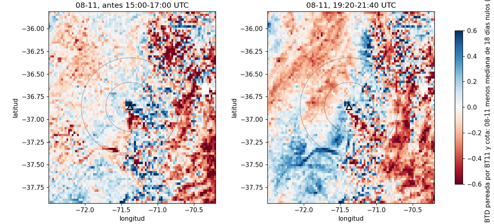

# H29 (S19h): ¿la pluma del 08-11 tiene firma en 11 y 12 µm lejos del cráter? Informe, 23-11-2026

**Veredicto por la regla escrita antes de medir: SEÑAL en la firma espectral (M1), NO CONCLUYENTE en el objeto frío
(M2).** Es la primera prueba de la serie que encuentra algo en los píxeles que VOLCAT publica para Chillán. La BTD
(11 − 12 µm) de los 17 píxeles-cuadro publicados a más de 30 km del cráter queda 0,37 K bajo la de píxeles del mismo
cuadro con su misma BT11 y su misma cota: más baja que en los 17 días sin evento y en el 0,5 % más bajo de 1.961
huellas corridas dentro del mismo día. Se repite en la huella sin corregir, en la huella dilatada y entre 15 y 30 km.

**Lo que no se puede afirmar todavía: que esa BTD baja sea de la pluma.** Las comprobaciones post hoc muestran que
ese día el campo de BTD tiene bandas meteorológicas de la misma amplitud (0,3 a 0,6 K), que en las mismas posiciones
la BTD baja empieza a las 19:20, unos 50 minutos antes de que VOLCAT ponga píxeles ahí, y que la potencia contra los
días nulos es baja (0,29). Lectura: **SOSPECHA de firma de pluma, no CONFIRMADO.**

Criterio subido antes de leer temperaturas: commit `b10f694`. Enmienda escrita tras el ensayo en seco y antes de
medir el 08-11: commits `52597bc` y `1f520bd`. Todo lo rotulado "post hoc" se decidió después de ver el resultado.
Archivos en
`C:\Users\nmend\OneDrive\Escritorio\claude\Volcanologia\Goes\.claude\worktrees\charming-napier-13552c\docs\own_volcat\h29_pluma_0811\`
mientras el PR no se fusione. Investigación: no toca el dashboard ni `src/`.

## 1. Para geólogo

**La idea.** El 08-11 es el evento VOLCAT más largo de Chillán (12:20 a 22:30 UTC). En el loop la pluma parecía
estirarse hacia el SE hasta la frontera. Lejos de la cumbre el fondo debería ser más quieto, y una pluma de 2 a 6 km
a decenas de kilómetros del cráter es el mejor caso que tiene el infrarrojo de 2 km. Ese día sólo se había medido
pegado al cráter.

**Lo que se vio antes de medir.**

1. **La pluma lejana es chica.** Leyendo el PNG de VOLCAT en la grilla de ABI, a más de 30 km del cráter hay 17
   píxeles-cuadro en todo el día, entre 20:10 y 22:00 UTC, de 0 a 4 por cuadro, hasta 57 km del cráter. Lo que en
   el loop se ve como "la pluma llega a la frontera" son pocos píxeles sueltos con alturas VOLCAT de 2,5 a 3,5 km.
   Sobre un terreno de unos 2,2 km, eso es una capa apenas 0,3 a 1,3 km sobre el suelo. No se comprobó contra el
   trazado de la frontera.
2. **No hay tardes despejadas para comparar.** De 18 días candidatos sin evento, a esas horas la máscara de nubes da
   cielo despejado en 0 a 2. La lección de H24 se repite: no se puede armar una línea base del propio píxel. Por eso
   la prueba compara cada píxel con otros píxeles del mismo cuadro y de la misma cota.
3. **El 08-11 mismo, la máscara de nubes marca nublados los píxeles lejanos** (8 de 10 cuadros). Una máscara de nubes
   también marca la ceniza, así que eso no decide. Lo que separa ceniza de nube es la diferencia 11 − 12 µm: una nube
   de hielo o de agua la sube, la ceniza la baja.

**Cómo se midió.** Para cada píxel publicado se buscaron píxeles del mismo cuadro con la misma temperatura de 11 µm
(± 0,5 K) y la misma cota (± 300 m), lejos de toda huella. Si el píxel tiene ceniza, su diferencia 11 − 12 µm debería
quedar más baja que la de esos pares, que son suelo o nube meteorológica de igual temperatura. Eso es M1. M2 compara
la temperatura de 11 µm del píxel con su anillo vecino de la misma cota. Cada estadístico se comparó contra los
mismos píxeles en 17 o 18 días sin evento y contra la misma huella corrida a otros lugares del mismo día.

**Lo que salió.**

- **M1, firma espectral: SEÑAL.** Mediana −0,37 K. En los días sin evento los mismos píxeles dan de −0,33 a valores
  positivos (mediana −0,04 K). La huella corrida a otros lugares del mismo día da −0,37 K o menos en sólo 0,5 % de
  los casos, y 0,5 % también si sólo se la corre a lugares al E del cráter y a 25 a 70 km. 15 de los 17
  píxeles-cuadro tienen M1 negativo. Los más bajos son los del parche desprendido de las 21:30 (−1,1 y −1,0 K, con
  diferencia 11 − 12 µm de −0,2 y 0,0 K en valor absoluto, que es lo más parecido a ceniza que hemos visto en Chillán).
- **M2, objeto frío: NO CONCLUYENTE.** Los píxeles están 1,4 K más fríos que su anillo, pero eso cae dentro de lo
  que pasa en días sin evento con nubes.
- **Qué tamaño de pluma sería.** Pintando capas sintéticas en los mismos píxeles, una baja de M1 de 0,33 K sobre lo
  normal corresponde a una capa con fracción por emisividad de unos 0,12: por ejemplo una pluma de 1 km de ancho
  (40 % del píxel) con emisividad 0,3, o una capa uniforme muy tenue (0,12). Esa misma capa enfriaría el píxel unos
  0,7 K contra su anillo, y lo observado (0,6 K más frío que lo normal) calza. Es decir: lo que se ve es una pluma
  tenue, no la capa casi opaca que haría falta para enfriar varios grados.

**Por qué no basta para decir "es la pluma".**

1. **El día tiene bandas.** En un mapa de la misma medida sobre toda la ventana (figura), entre 19:20 y 21:40 la BTD
   baja en franjas inclinadas que cruzan la ventana, también al O y NO del cráter, contra el viento, donde la pluma no
   puede estar. El sector SE (a favor del viento) es el que tiene más píxeles bajo el 5 % de los días sin evento
   (28 a 35 %, contra 0 a 19 % en los otros sectores), pero la diferencia es de grado, no de forma: no aparece una
   franja limpia que salga del cráter.
2. **Empieza antes que VOLCAT.** En las 14 posiciones donde VOLCAT publica píxeles lejanos, la BTD del 08-11 es normal
   de 14:00 a 19:10, baja desde las 19:20 (bajo el mínimo de los días sin evento a las 19:20, 20:00, 20:20 y 21:10) y
   vuelve a lo normal desde las 21:20 a 21:50. VOLCAT pone píxeles ahí recién desde las 20:10. Puede ser una pluma
   más ancha o más temprana que lo que VOLCAT dibuja (VOLCAT ya tenía píxeles a 23 a 27 km del cráter desde las
   19:10), o un transitorio del tiempo que VOLCAT siguió. Con 11 y 12 µm solos no se separan.
3. **Un día sin pluma estuvo cerca.** En el ensayo en seco, la misma huella puesta el 04-11 dio −0,26 K, el segundo
   valor más bajo de 17, con 5 % de las huellas corridas por debajo. El 08-11 lo supera (−0,37 K, 0,5 %), pero el
   margen contra los días nulos es corto (el mínimo nulo es −0,33 K).
4. **Potencia baja contra los días nulos.** Como esas tardes casi siempre están nubladas, una pluma de referencia
   (1 km de ancho, emisividad 0,5) sólo se detecta en 29 % de los días nulos: queda escondida bajo nubes más altas.
   El 08-11, en cambio, 94 % de los píxeles lejanos está más tibio que la temperatura de la capa, y ahí la pluma de
   referencia sí habría quedado en el 0,1 % más bajo de las huellas corridas. La prueba podía ver algo ese día.

**Conclusión.** Por primera vez una prueba encuentra, en los píxeles que VOLCAT publica para Chillán, una diferencia
11 − 12 µm más baja que la de su entorno de igual temperatura, fuera del rango de los días sin evento y de los otros
lugares del mismo día. Es débil (0,37 K), del tamaño de una pluma tenue que llena parte del píxel, y no se puede
separar todavía de las bandas meteorológicas de esa tarde. Cambia la lectura de "VOLCAT publica sin ninguna firma
IR" a "lejos del cráter, el 08-11, hay una firma débil compatible con ceniza tenue, sin atribución demostrada". La
forma de cerrarla es repetir la misma prueba, sin tocar la regla, en otro evento con píxeles lejanos (el 14-11 ya
tiene los suyos en H22, con otra medida) y mirar si la firma acompaña el desplazamiento de la huella cuadro a cuadro.

## 2. Datos y lo que se midió antes del criterio

Script `scripts/h29_preparar.py` (no lee temperaturas). Salidas: `resultados/preparar_por_cuadro.csv`,
`resultados/preparar_resumen.json`.

- **Huella.** PNG `Ash_Height` de VOLCAT, sector `Chile_Central_2_km`, 64 cuadros de 12:00 a 22:50 UTC, en
  `D:\goes_notas\volcat_validacion_copia_2026-11-21\Chile_Central_2_km\frames\`. Lectura de colores de
  `src/process/volcat_colorbar.py` (saturación ≥ 0,2, bloque de la barra), llevada a la ventana ABI de 83 × 94 por
  vecino más cercano, como `reproducir_volcat/scripts/huella_png.py`. Barra leída en 64 de 64 cuadros. Ningún píxel con
  color a 200 km o menos del cráter cae fuera de la ventana: no se bajó nada.
- **Georreferencia.** La grilla de lat/lon y la capa de volcanes del PNG se dibujan con la esquina superior izquierda
  del glifo en la coordenada: el borde superior de cada paralelo cae en la fila calculada (± 0,5) y la esquina del
  glifo de Chillán, Antuco, Callaqui, Copahue y Longaví a menos de 1,5 px de su posición calculada. Eso explica los
  3,07 px de S16 (se midió el centroide del triángulo). Como ninguna capa dice dónde se dibuja un píxel de dato, la
  huella principal usa el corrimiento que H14 midió contra archivos de evento (1 fila al N, 1 columna al O), con la
  lectura nominal y la dilatada como sensibilidad.
- **Población.** A más de 30 km: 17 píxeles-cuadro en 10 cuadros (20:10, 20:20, 20:30, 20:40, 20:50, 21:00, 21:10,
  21:30, 21:40 y 22:00). Entre 15 y 30 km: 102 píxeles-cuadro de 15:20 a 21:30.
- **Fondo.** Días candidatos: ± 21 días del 08-11 sin los 17 que excluye H24 (objeto o marca VOLCAT, pulso REAV o
  VCB): 18 días. La regla E1 de H23 (≥ 80 % del terreno bajo despejado) se cumple en 0 a 2 de ellos por cuadro.
- **L1b.** Cubos C14 y C15 de H23 y del hueco de H24 (21-09 al 21-11), ACMF y GFS de los mismos. Coeficientes de
  Planck iguales en los tres cubos (comprobado al cargar).

## 3. Diseño (criterio y enmienda)

`criterio_2026-11-23.md` y `enmienda_1_antes_de_medir_2026-11-23.md`. En corto:

- **M1** = BTD del píxel menos la mediana de BTD de sus pares (mismo cuadro, BT11 ± 0,5 K, cota ± 300 m, a 4 px o más
  de toda huella de ± 20 min, mínimo 10). **M2** = BT11 menos la mediana del anillo de 2 a 8 px de la misma cota.
  Estadístico: mediana sobre los píxeles-cuadro válidos (mínimo 10).
- **Nulo A:** mismos píxeles-cuadro en los días candidatos, con todo cielo. **Nulo B:** huella corrida
  (|Δ| ≤ 25 px) dentro del 08-11, lejos de toda huella del día.
- **Control positivo:** I' = (1 − f·ε)·I + f·ε·B(T_tope) por canal, ε12 = 1 − (1 − ε11)^0,7, T_tope del GFS a la
  altura VOLCAT. Pluma de referencia f = 0,4, ε11 = 0,5.
- **Enmienda 1 (antes de medir el 08-11).** El ensayo en seco mostró que el z robusto daba 5 de 16 falsas alarmas y
  que la capa sintética "calentaba" píxeles nublados. Se pasó a rango (señal = bajo el mínimo del nulo; nulo = en o
  sobre el percentil 25) y la capa no cambia un píxel ya más frío que ella. Se agregó, sólo como información, la
  potencia en el propio 08-11 contra el nulo B.

**Las dos preguntas del instrumento.**

1. *Si la medición estuviera rota, ¿la prueba fallaría?* Sí: la capa pintada pasa por el mismo código. En el propio
   08-11 la pluma de referencia queda en el 0,0 % más bajo del nulo B en M1 y M2 la mueve de 11 % a 6 %. Contra el
   nulo A la potencia es baja (M1 0,29, M2 0,06), por las tardes nubladas: por eso un "sin firma" habría salido SIN
   PODER, no "sin firma".
2. *Si el instrumento estuviera muerto, ¿se vería distinto?* Sí: los 17 de 17 píxeles-cuadro tienen L1b finita y
   pares; con bandas vacías habría SIN DATO. Los nulos se midieron: en el ensayo en seco y en los días nulos el
   estadístico tiene una mediana cerca de cero (−0,04 K) y falsas alarmas de 1 en 17. El 08-11 no es un cero.

## 4. Resultado contra la regla

Salidas: `resultados/h29_resultado.json`, `resultados/h29_medir.log`. Script `scripts/h29_medir.py`.

**Población que decide (huella corrida según H14, > 30 km, 17 píxeles-cuadro):**

| Medida | 08-11 | Nulo A: mínimo / P25 / mediana (días) | Días nulos ≤ 08-11 | Nulo B: p (corrimientos) | Falsas alarmas A | Potencia ref. (A) | Veredicto |
|---|---|---|---|---|---|---|---|
| M1, BTD pareada por BT11 | −0,372 K | −0,332 / −0,166 / −0,042 (17) | 0 | 0,005 (1.961) | 1 de 17 | 0,29 | **SEÑAL** |
| M2, BT11 contra anillo | −1,40 K | −4,15 / −1,97 / −0,83 (18) | 8 | 0,115 (1.961) | 1 de 18 | 0,06 | NO CONCLUYENTE |

**Sensibilidad e información (no deciden):**

| Variante | Píxeles-cuadro | M1 (mín. nulo; p) | Clase M1 | M2 (p) | Clase M2 |
|---|---|---|---|---|---|
| Huella nominal, sin corregir | 23 | −0,649 K (−0,276; 0,000) | SEÑAL | −1,03 K (0,118) | NO CONCLUYENTE |
| Huella dilatada 1 px | 81 | −0,372 K (−0,264; 0,001) | SEÑAL | −1,35 K (0,104) | NO CONCLUYENTE |
| 15 a 30 km | 102 | −0,765 K (−0,525; 0,000) | SEÑAL | −1,80 K (0,050) | SOSPECHA |

El veredicto de M1 no depende de la georreferencia: con la huella nominal el efecto es mayor, no menor.

**Ensayo en seco (04-11 en el lugar del 08-11, `resultados/seco_0411.json`):** M1 −0,263 K (segundo de 17), p 0,052,
NO CONCLUYENTE; M2 SIN PODER. No dio SEÑAL.

**Potencia en el propio 08-11 contra el nulo B** (información, `p_pintado_dia_ev`): con la pluma de referencia, M1 da
p 0,000 y M2 p 0,064; 94 % de los píxeles-cuadro lejanos está más tibio que T_tope (la capa sería visible).

## 5. Post hoc (decidido después de ver la SEÑAL)

Scripts `scripts/h29_posthoc.py`, `scripts/h29_mapa.py`, `scripts/h29_equivalencia.py`. Salidas
`resultados/posthoc.json`, `resultados/mapa_sectores.json`, `resultados/equivalencia.json`,
`figuras/mapa_anomalia_btd.png`.

**Por cuadro** (M1 de cada píxel-cuadro, K): 20:10 +0,11 y −0,40; 20:20 −0,19 y −0,49; 20:30 −0,95; 20:40 −0,36;
20:50 −0,55; 21:00 +0,14; 21:10 −0,26, −0,44 y −0,33; 21:30 −1,10, −0,98, −0,37 y −0,33; 21:40 −0,54; 22:00 −0,28.
Percentiles 10, 25, 50, 75 y 90: −0,96, −0,54, −0,37, −0,28 y −0,07 K. 88 % negativos.

**Nulo B al E del cráter** (corrimientos que dejan la huella al E del cráter y a 25 a 70 km): 384 corrimientos,
p = 0,005. No es un gradiente E-O del día.

**Serie de tiempo en las mismas 14 posiciones** (mediana de M1; entre paréntesis, mínimo de los 18 días nulos):

| Tramo UTC | 08-11 | Cuadros bajo el mínimo nulo | VOLCAT con píxeles en esas posiciones |
|---|---|---|---|
| 14:00 a 19:10 | −0,41 a +0,18 K | 0 de 32 | no |
| 19:20 a 21:10 | −0,50 a −0,16 K | 4 de 12 (19:20, 20:00, 20:20, 21:10) | desde 20:10 |
| 21:20 a 23:50 | −0,19 a +0,15 K | 0 de 16 | 21:30, 21:40 y 22:00 |

**Mapa por sectores** (anomalía media respecto de la mediana de los días nulos y fracción de píxeles bajo su percentil
5; sectores por rumbo desde el cráter):

| Sector | 15:00 a 17:00 | 19:20 a 21:40 |
|---|---|---|
| SE, 10 a 30 km | +0,02 K; 14 % | −0,08 K; 35 % |
| SE, 30 a 60 km | +0,03 K; 7 % | −0,10 K; 28 % |
| E, 30 a 60 km | −0,03 K; 8 % | −0,07 K; 19 % |
| N, 30 a 60 km | +0,01 K; 3 % | −0,03 K; 16 % |
| O-NO, 30 a 60 km | −0,03 K; 2 % | −0,15 K; 10 % |
| S-SO, 30 a 60 km | −0,01 K; 4 % | +0,11 K; 1 % |

Rojo: BTD más baja que en los días sin evento a igual BT11 y cota (lado ceniza). Triángulo: cráter; círculos de 30 y
60 km. Sin huella VOLCAT (derivada de SSEC, queda en D:). A la derecha, el tramo de la pluma lejana: franjas
inclinadas que cruzan toda la ventana y un borde E (lado argentino) rojo que ya estaba a las 15:00 a 17:00.

**Equivalencia** (capa uniforme visible pintada en los días nulos, cambio mediano por píxel-cuadro):

| f·ε11 | Cambio de M1 | Cambio de M2 |
|---|---|---|
| 0,02 | −0,05 K | −0,12 K |
| 0,05 | −0,13 K | −0,30 K |
| 0,10 | −0,27 K | −0,60 K |
| 0,20 | −0,50 K | −1,20 K |
| 0,30 | −0,74 K | −1,81 K |
| 0,50 | −1,08 K | −3,03 K |

El 08-11 está 0,33 K bajo la mediana nula en M1 (f·ε ≈ 0,12) y 0,57 K bajo ella en M2 (f·ε ≈ 0,10). Las dos medidas
apuntan a la misma capa: tenue, o una pluma angosta.

## 6. Lo que esto cambia y lo que no

- Cambia: hasta H28 ninguna prueba había encontrado firma IR en las plumas de Chillán. Lejos del cráter, el 08-11,
  M1 la encuentra por la regla. La firma es débil y del tamaño de lo que una pluma tenue y angosta haría.
- No cambia: la explicación de §1 y §3.9 de `POR_QUE_VOLCAT_VE_Y_NOSOTROS_NO.md` (nacimiento del objeto y
  seguimiento por distancia) sigue siendo la que explica cuándo VOLCAT publica. H29 no dice que VOLCAT detecte por
  firma: dice que en este caso, donde publica lejos, el píxel tiene una BTD algo más baja que su entorno.
- Este informe no edita ese documento ni `STATUS.md`; eso lo decide S19 con Nicolás.

## 7. Lo que puede salir mal en esta lectura

- 17 píxeles-cuadro de un solo evento, correlacionados entre vecinos y cuadros seguidos (H22).
- El margen contra el nulo A es corto (−0,37 contra −0,33 K de mínimo) y el 04-11 sin pluma llegó a −0,26 K.
- El campo de BTD de esa tarde tiene bandas de 0,3 a 0,6 K; una de ellas puede coincidir con la huella.
- La huella sale del PNG, no de un archivo de evento. La sensibilidad cubre corrimientos de 1 px.
- No hay 8,4 µm en el cubo; H22 lo usó post hoc y aquí no se pudo.

## 8. Próximo paso sugerido

Repetir `scripts/h29_medir.py` sin cambiar la regla en el 14-11 (H22 midió otra cosa: BT11 contra línea base) y en
cualquier otro evento con píxeles lejanos, y probar si la firma se mueve con la huella cuadro a cuadro (correlación
entre el desplazamiento de la huella y el del mínimo de M1). Si se repite en otro evento, la SOSPECHA pasa a ser
firma; si no, queda como coincidencia con una banda meteorológica del 08-11.

## 9. Archivos

- Repo (esta carpeta): `criterio_2026-11-23.md`, `enmienda_1_antes_de_medir_2026-11-23.md`, este informe,
  `scripts/` (h29_comun, h29_preparar, h29_medir, h29_posthoc, h29_mapa, h29_equivalencia), `resultados/` (tablas por
  cuadro o agregadas, sin posiciones), `figuras/mapa_anomalia_btd.png`.
- Fuera del repo, en `D:\goes_notas\s19\h29\`: `huella_0811.npz` (huella por píxel, derivada del PNG de SSEC),
  `descriptivo_lejanos.csv` (BT11, BTD, ACMF y T del GFS por píxel-cuadro), `posthoc_completo.json`,
  `mapa_anomalia.npz`. No se bajó nada nuevo; D: queda con unos 14,9 GB libres.
