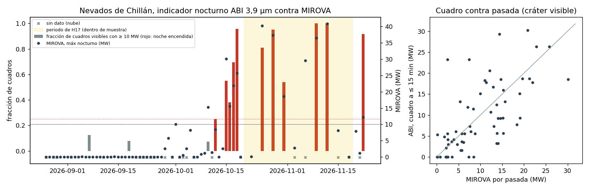

# Indicador nocturno de calor en el cráter (VRP a 3,9 µm desde la L1b de GOES-19): validación fuera de muestra. Informe, 22-11-2026

**Veredicto (reglas del criterio): VALIDA**, con una muestra de detección chica. Las cuatro pruebas que deciden
cumplen: detección 5 de 6 noches en que MIROVA ve a Chillán sobre 10 MW (IC 95 % de 44 a 97 %), falsa alarma 0 de 144
noches en siete cumbres sin actividad (IC 95 % hasta 2,6 %), 0 de 19 noches encendidas en Chillán antes de que se
calentara, y un retardo de una noche con dato contra la primera noche de MIROVA sobre 10 MW.

Criterio escrito y subido antes de medir: commit `e42a895`,
`C:\Users\nmend\OneDrive\Escritorio\claude\Volcanologia\Goes\docs\own_volcat\vrp_nocturno\criterio_2026-11-22.md`
(mientras no se fusione, en
`C:\Users\nmend\OneDrive\Escritorio\claude\Volcanologia\Goes\.claude\worktrees\vrp-nocturno-59a4a2\docs\own_volcat\vrp_nocturno\`).
Investigación: nada de esto toca el dashboard ni `src/`.

## 1. Para geólogo

**Qué se quería saber.** H17 dejó, como dato informativo, que el canal de 3,9 µm de GOES-19 ve de noche el calor del
cráter de Nevados de Chillán que el hot spot FDCF de NOAA no ve. A 3,9 µm la radiancia crece con la temperatura mucho
más rápido que a 11 µm: un material incandescente que cubre una fracción mínima del píxel de 2 km sube la temperatura
de brillo de 3,9 µm varios kelvin y casi nada la de 11 µm. Con el exceso de radiancia se calcula la potencia radiativa
volcánica (VRP, método del infrarrojo medio de Wooster y otros 2003), en las mismas unidades que MIROVA. La pregunta de
esta prueba era si eso funciona como indicador, fuera de los datos donde se encontró.

**Contra qué se midió.** MIROVA (MODIS y VIIRS, píxeles de 375 m a 1 km, mucho más sensibles que ABI), leído de la
salida publicada de VRP Chile. MIROVA pasa una o dos veces por noche; ABI mira cada 10 min (aquí se usaron cuadros cada
30 min). La comparación es por noche.

**Lo que salió.**
- **Chillán se enciende cuando MIROVA lo ve sobre 10 MW** y se apaga cuando no. Antes del 28-09 el cráter estaba frío
  según MIROVA (máximo 0,1 MW) y el indicador no se encendió ninguna noche (0 de 19 con dato). MIROVA marca la primera
  noche sobre 10 MW el 10-10; el indicador se enciende el 12-10 (una noche con dato después) y queda encendido del 15
  al 18-10 junto con MIROVA (15 a 30 MW). El 22-11, con MIROVA a 12 MW, también se enciende. La única noche P que no
  enciende es la del 10-10: el cráter estuvo visible, la VRP llegó a 18 MW, pero sólo en 1 de 14 cuadros (el pulso
  fue corto). La prensa, citando al SERNAGEOMIN, informa incandescencia en el centro de emisión la madrugada del 27-09,
  coherente con el inicio de MIROVA (28 y 29-09, 2,6 y 5,7 MW).
- **No se enciende en cumbres sin actividad**: 0 de 144 noches con dato en Parinacota, Tinguiririca, Descabezado
  Grande, Lonquimay, Lanín, Osorno y Hudson (de −18° a −46°, de 1,9 a 6,3 km), y 0 de 69 en Antuco y Longaví fuera del
  periodo de H17. Con el corte de 5 MW hay una noche en Osorno.
- **Mide la misma potencia que MIROVA**: en 63 pasadas con el cráter visible, la VRP del cuadro ABI más cercano y la de
  MIROVA se ordenan igual (Spearman 0,70) y, con MIROVA sobre 5 MW, ABI da en mediana 0,86 veces lo de MIROVA. Es una
  calibración independiente: la fórmula de ABI no usa nada de MIROVA.
- **Su límite es del orden de 5 a 10 MW.** En los diez volcanes con actividad térmica débil que sigue MIROVA (Láscar,
  Villarrica, Isluga, Lastarria, Tupungatito, Planchón-Peteroa, Copahue, Llaima, Puyehue-Cordón Caulle, Chaitén), con
  máximos MIROVA de 0,2 a 4,8 MW en las noches medidas, el indicador nunca se enciende y la VRP de ABI es 0 en el 90 %
  de los cuadros visibles. No es una falla: un píxel de 4,5 a 7,5 km² no puede ver un lago de lava de 1 MW. **Que el
  indicador esté apagado no dice que el volcán no tenga calor: dice que no hay más de ~10 MW.**
- **Control positivo fuerte**: Sangay (Ecuador, del catálogo de prueba del repo, casi en nadir) se enciende en 15 de 22
  noches con dato, VRP mediana de 64 MW en los cuadros visibles. La regla ve una fuente grande cuando la hay.
- **FDCF no vio nada**: en los mismos cuadros visibles de Chillán, en las 13 noches P y débiles fuera de muestra, el FDCF
  de NOAA no marcó ningún píxel de fuego a 10 km del cráter (0 de 13 noches; el indicador, 6 de 13). En 624 cuadros
  nocturnos desde el 25-09, ninguno. Revisado que la lectura funciona: en esos cuadros la máscara FDCF dice "procesado,
  sin fuego" o nube, no "sin dato". Calza con H9.

**La nube es la limitación principal.** Chillán tuvo dato en 35 de 52 noches fuera de muestra; del 20 al 25-09 el
cráter estuvo seis noches seguidas bajo nube (BT14 de 237 a 262 K contra 274 K despejado). El indicador lo marca como
"sin dato", nunca como apagado. Eso tiene que verse igual en el dashboard.

**Qué significa.** Es un indicador de **estado** (cráter con material incandescente sobre ~10 MW, noche a noche), no un
detector de explosiones ni de ceniza. Lo que agrega a lo que ya hay: ve, cada 10 minutos y sin depender de pasadas
polares, el calor de Chillán que el FDCF de NOAA no ve. Lo que no puede: ver actividad débil, ver de día, ver con nube.

## 2. Números (salida cruda en `resultados/vn_resultado.txt`)

| Prueba | Pide | Da | Resultado |
|---|---|---|---|
| V1, detección (Chillán, noches MIROVA ≥ 10 MW con dato) | ≥ 70 %, ≥ 5 noches | 5/6 = 83 % [44 a 97 %] | cumple |
| V2, falsa alarma (7 controles nuevos) | ≤ 2 %, ningún control > 2 noches | 0/144 = 0 % [0 a 2,6 %] | cumple |
| V3, Chillán antes del encendido | ≤ 5 % | 0/19 [0 a 17 %] | cumple |
| V4, retardo | ≤ 3 noches con dato tras la primera P y no antes de la primera ≥ 5 MW | primera encendida 12-10; P 10-10; ≥ 5 MW 29-09; retardo 1 | cumple |
| **Veredicto** | | | **valida** |

Informativo:

| Medida | Resultado |
|---|---|
| Chillán, noches MIROVA débiles (1 a 10 MW) | 1/7 encendidas (12-10, MIROVA 8,4 MW) |
| Chillán, noches en que MIROVA miró y no vio (< 1 MW) | 0/22 |
| Chillán dentro de muestra (20-10 a 19-11, una noche de cada tres) | 5/6 noches con dato encendidas |
| Antuco y Longaví fuera del periodo de H17 | 0/33 y 0/36 |
| Controles con corte 5 MW | 1/144 (Osorno) |
| Activos débiles (10 volcanes, 201 noches con dato) | 0 encendidas |
| Sangay | 15/22 [47 a 84 %] |
| Cuadro contra pasada (63 con cráter visible) | Spearman 0,70; ABI/MIROVA mediana 0,86 (44 pasadas ≥ 5 MW) |
| FDCF, mismas noches | 0 de 13 noches con algún cuadro de fuego |

Noches de Chillán con cuadros aislados sobre 10 MW que la regla no encendió: 07-09 (3 de 24 cuadros, 36 MW máx) y
18-09 (1 de 13), las dos con MIROVA en cero. La condición de que sean al menos el 25 % de los cuadros visibles de la
noche es la que las filtra; sin ella habrían sido falsas alarmas en el volcán mismo.

## 3. Límites

- **Muestra de detección chica.** Seis noches P fuera de muestra; el intervalo de V1 va de 44 a 97 %. Que cumpla dice
  que la regla no es mala, no que se sepa su sensibilidad con precisión. Las noches dentro de muestra (5/6) apuntan a lo
  mismo, pero no cuentan.
- **Un solo volcán chileno sobre el límite.** En el periodo con datos GOES-19 medidos, sólo Chillán superó 10 MW en
  MIROVA. El comportamiento en otro tipo de fuente (lago de lava, domo, colada larga) sólo está visto en Sangay y sin
  verdad por noche.
- **Los controles no tienen verdad "sin calor" medida**: MIROVA no sigue esos siete volcanes. Se eligieron por no tener
  actividad térmica informada. Su resultado (0 de 144) es lo que se espera si eso es cierto.
- **Cadencia de 30 min** en la validación. El operativo tendría 10 min (tres veces más cuadros por noche); el umbral es
  una fracción, así que no debería cambiar, pero no está medido.
- **Sin corrección atmosférica** y con la aproximación de Wooster (hasta 24 % de error). La razón ABI/MIROVA de 0,86 es
  coherente con eso; el corte de 10 MW es nominal.
- **Sólo de noche.** De día el 3,9 µm suma sol reflejado (H17: 12 % de cuadros con 10 MW en cumbres de control).
- **La referencia de cielo despejado usa las 7 noches previas.** Tras una nevada que enfríe la cumbre más de 4 K, el
  cráter puede quedar "sin dato" varios días aunque esté despejado. Es un error conservador (no da calma falsa), pero
  resta noches con dato.

## 4. Archivos

- Criterio: `C:\Users\nmend\OneDrive\Escritorio\claude\Volcanologia\Goes\docs\own_volcat\vrp_nocturno\criterio_2026-11-22.md`
- Scripts: `C:\Users\nmend\OneDrive\Escritorio\claude\Volcanologia\Goes\docs\own_volcat\vrp_nocturno\scripts\`
  (`vn_comun.py` regla y geometría, `vn_bajar.py` descarga, `vn_fdcf.py` FDCF, `vn_medir.py` pruebas,
  `vn_figura.py` figura).
- Resultados: `C:\Users\nmend\OneDrive\Escritorio\claude\Volcanologia\Goes\docs\own_volcat\vrp_nocturno\resultados\`
  (`vn_resultado.txt`, `noches.csv`, `cuadros.csv`, `cuadro_contra_pasada.csv`, `vn_chillan.png`).
- Fuera del repo: `D:\goes_cache\vrp_nocturno\` (`l1b\` 1.619 cuadros, `mirova\` copia de la salida publicada de
  VRP Chile del 22-11-2026 03:05, `fdcf.csv`, `cuadros.pkl`, `bajar.log`).
- Reproducir (Git Bash, desde `scripts\`, con `TMP` y `TEMP` en `D:\goes_cache\tmp`): bajar los JSON de MIROVA de
  `https://raw.githubusercontent.com/MendozaVolcanic/VRP-chile/main/data/mirova/<volcán>.json` a
  `D:\goes_cache\vrp_nocturno\mirova\`, luego `python vn_bajar.py 10` (~30 min), `python vn_fdcf.py 6` (~2 min),
  `python vn_medir.py` y `python vn_figura.py`. La salida de MIROVA cambia con el tiempo (VRP Chile la regenera):
  para reproducir exactamente, usar la copia en `D:`.
